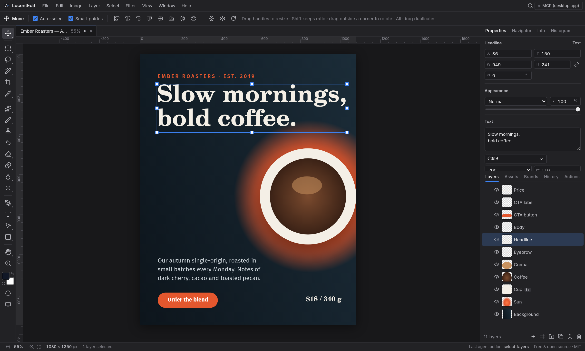
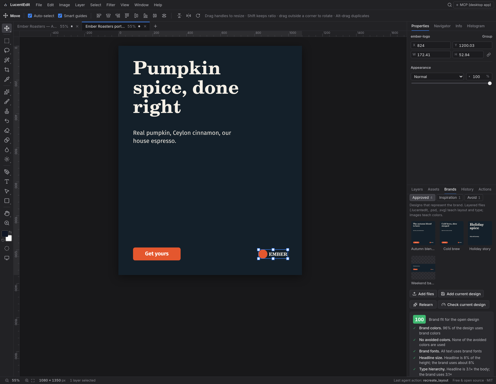
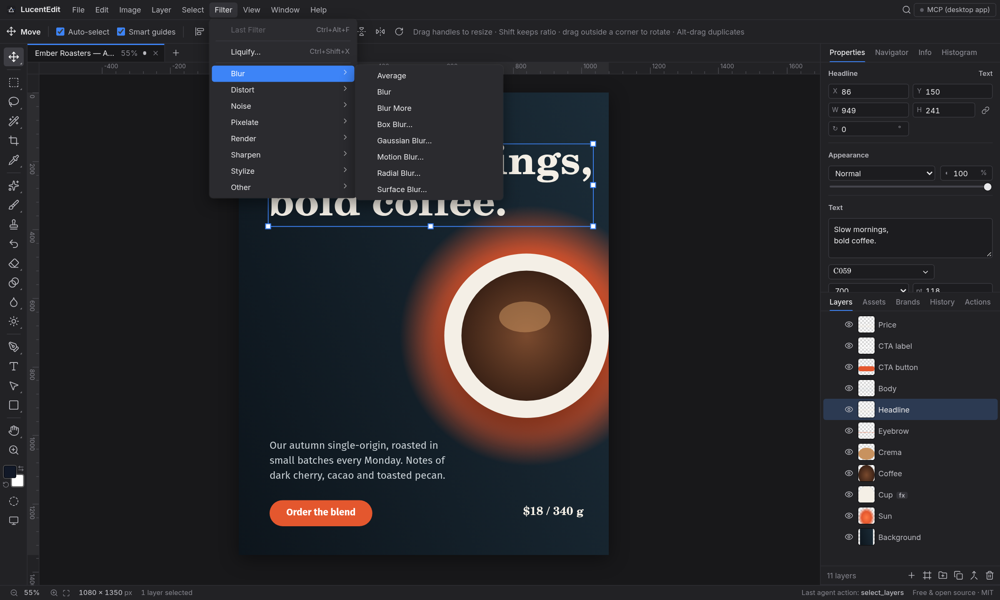
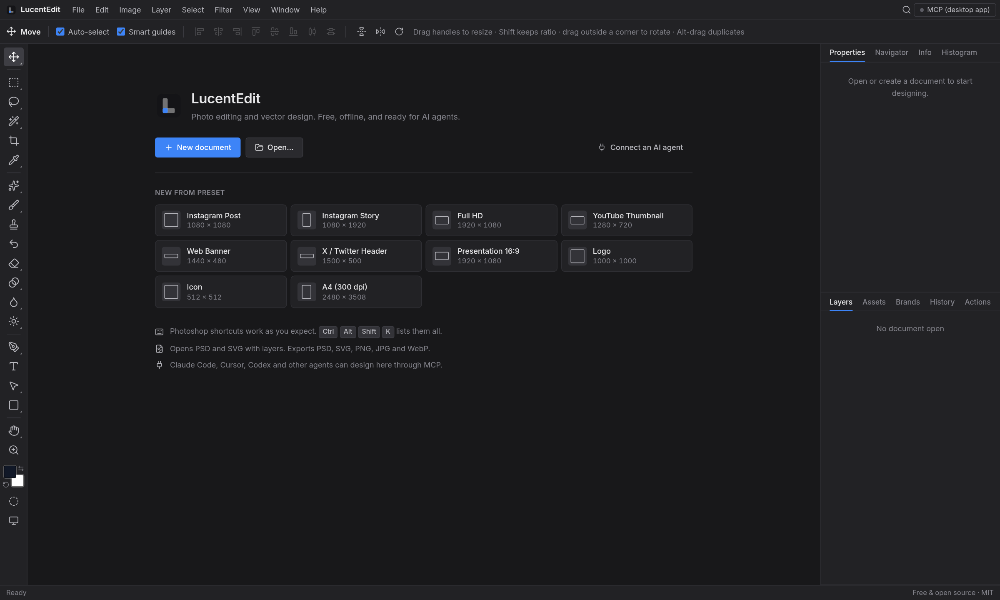
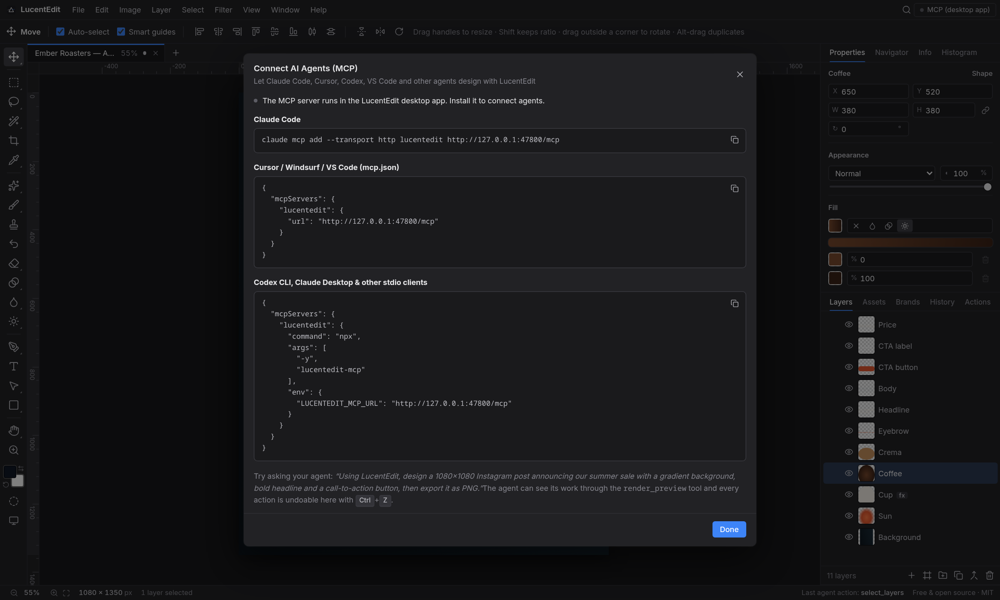

<div align="center">

<picture>
  <source media="(prefers-color-scheme: dark)" srcset="docs/brand/lockup-dark.png" />
  
</picture>

**The free, lightweight, open-source Photoshop + Illustrator alternative, built for humans and AI agents.**

Layers, pen paths, filters, Photoshop (PSD) and Illustrator (AI) files, and a built-in MCP server so Claude, Cursor, Copilot, Codex, Gemini and any other AI coding agent can design for you.
No signup. No login. No subscription. A 2 MB Linux package and a 4 MB app binary.

[](LICENSE)
[](#install)
[](https://github.com/Tanvir-Chowdhury/LucentEdit/releases/latest)
[](https://github.com/Tanvir-Chowdhury/LucentEdit/releases)
[](#use-with-ai-agents-mcp)

[Install](#install) · [Use with AI agents](#use-with-ai-agents-mcp) · [Shortcuts](#coming-from-photoshop--illustrator) · [Build from source](#build-from-source) · [Roadmap](#roadmap)

<br />



<sub>A poster built entirely by an AI agent through the built-in MCP server, open in the LucentEdit editor.</sub>

</div>

---

## Table of contents

- [Screenshots](#screenshots)
- [Why LucentEdit](#why-lucentedit)
- [Features](#features)
- [Install](#install)
  - [macOS](#macos)
  - [Windows](#windows)
  - [Linux](#linux)
  - [Manual downloads](#manual-downloads)
  - [Uninstall](#uninstall)
- [Use with AI agents (MCP)](#use-with-ai-agents-mcp)
  - [Client setup](#client-setup)
  - [MCP tools](#mcp-tools)
  - [Example prompts](#example-prompts)
- [Coming from Photoshop / Illustrator](#coming-from-photoshop--illustrator)
- [Build from source](#build-from-source)
- [Project structure](#project-structure)
- [Roadmap](#roadmap)
- [Contributing](#contributing)
- [License](#license)

## Screenshots

<table>
  <tr>
    <td width="50%"></td>
    <td width="50%"></td>
  </tr>
  <tr>
    <td><b>Brand Training.</b> LucentEdit learns a brand's style from its past designs. This poster was rebuilt from one of the brand's own layouts, and it scores 100 for brand fit.</td>
    <td><b>Photoshop-style menus and shortcuts.</b> 50+ filters, adjustment layers, Liquify, Warp and Content-Aware Fill, where Photoshop users expect them.</td>
  </tr>
  <tr>
    <td></td>
    <td></td>
  </tr>
  <tr>
    <td><b>Start in seconds.</b> Presets for every social, video and print size. No account, works offline.</td>
    <td><b>Connect any AI agent.</b> One command for Claude Code, a config snippet for Cursor, VS Code, Codex and other MCP clients.</td>
  </tr>
</table>

## Why LucentEdit

- **Free forever.** MIT licensed, no account, no paywalled features.
- **Light.** Native Tauri shell with the system webview: the `.deb`/`.rpm` packages are about 2 MB, the app uses a fraction of the memory of Electron apps and runs on low-spec PCs. (The portable AppImage is ~110 MB because it bundles its own WebKit.)
- **One app for pixels and vectors.** Raster painting and Illustrator-style pen paths live in the same layer stack.
- **AI-native.** A local MCP server is built in. Any agent can create documents, draw, apply filters, look at a rendered preview and export, while you watch it happen live.
- **Familiar.** Photoshop keyboard shortcuts and terminology. Opens and saves Photoshop `.psd` and Illustrator `.ai` files with editable layers and text.

## Features

| Area | What you get in v0.1 |
| --- | --- |
| **Documents** | Multi-document tabs, 12 size presets, native `.lucentedit` format, open PNG/JPG/WebP/GIF/SVG/PSD/AI/PDF, drag & drop and paste images from the clipboard, Image Size, Canvas Size, rotate/flip canvas, trim |
| **Layers** | Raster, vector shapes, pen paths, text, groups, **Smart Objects** (scale without quality loss, Edit Contents in a new tab, changes sync back), adjustment layers and fill layers (solid, gradient). Blend modes, opacity, lock, visibility, drag to reorder, Layer via Copy/Cut, Merge Down/Visible, Stamp Visible, Flatten |
| **Selection & transform** | Move with free transform (resize, rotate), snapping and smart guides, Rectangular/Elliptical/Single Row/Single Column Marquee, Lasso, Polygonal Lasso, Magnetic Lasso, Magic Wand, Quick Selection, Crop. Select > Color Range, Modify (Border, Smooth, Expand, Contract, Feather), Grow, Similar, Reselect, Save/Load Selection, Quick Mask |
| **Painting & retouching** | Brush, Pencil, Color Replacement, Eraser, Background Eraser, Magic Eraser, Paint Bucket, Gradient, Clone Stamp, Healing Brush, Spot Healing Brush, Red Eye, History Brush, Blur, Sharpen, Smudge, Dodge, Burn, Sponge |
| **Vector** | Pen, Freeform Pen, Add/Delete Anchor Point, Convert Point, Path Selection, Direct Selection, Rectangle, Ellipse, Triangle, Polygon, Star, Line, Custom Shapes |
| **Measure & view** | Eyedropper, Color Sampler (Info panel readouts), Ruler with Straighten, Rotate View, guides (drag from rulers, snapping, lock, New Guide, Guides From Shape), screen modes, Navigator, Info and Histogram panels |
| **Text** | Point and paragraph text edited directly on the canvas, font family/weight/size, line height, tracking, alignment, gradient and stroked text |
| **Fill & stroke** | Solid, linear and radial gradient fills. Strokes with dash, cap and join |
| **Effects** | Drop shadow, outer glow |
| **Transform & distort** | Free Transform plus Edit > Transform > Skew, Distort, Perspective (straight lines stay straight) and Warp (Bezier mesh with Arc, Bulge, Flag, Wave, Fish, Rise, Inflate, Twist presets), and Filter > Liquify (Forward Warp, Reconstruct, Pucker, Bloat, Twirl) |
| **Content-aware** | Edit > Content-Aware Fill (PatchMatch inpainting in a background worker), Select > Subject and Select > Sky. All run on your machine with no AI model downloads, so they are estimates rather than Photoshop's cloud ML |
| **Assets library** | Pick any folder on your computer: each subfolder is a category (Logos, Icons, Photos, Backgrounds, Textures, Illustrations, Templates, Fonts by default). Browse, search by name or tag, click or drag to place, save layers as PNG/SVG/layered assets, keep brand color palettes. Fonts in the folder show up in the Type tool. Everything is plain files plus a `library.json`, so it syncs with Dropbox/Drive/git |
| **Brands** | Manage any number of brands. Each brand has its own asset categories (Logos, Icons, Photos, Graphics, Templates, Fonts), named colors with roles (primary, secondary, accent, text, background), heading/body/accent fonts with weights, a tagline, website and written guidelines. Set an active brand, apply brand fonts and colors to selected layers in one click. Stored as `Brands/<name>/brand.json` in your Assets folder |
| **Brand Training** | Teach LucentEdit how each brand designs. Every brand gets a training library: **Approved** past designs, **Inspiration** (references: only layout ideas are learned, never their colors or fonts) and **Avoid** (don'ts, with a note). LucentEdit analyzes them into a Brand Style Profile: palette and its proportions, light or dark grounds, headline size and type hierarchy, fonts per role, margins, empty space, logo and headline placement, and the brand's recurring layouts. Start a new document from a learned layout, filled with the brand's own fonts, colors and logo, and score any design for brand fit (0-100, with fixes). Works per brand, fully offline, no model training: the profile is plain JSON at `Brands/<name>/Training/style.json` |
| **Fonts** | Every font installed on your computer is available (read directly from the system on Windows, macOS and Linux), plus fonts from your Assets folder and brands, in a searchable picker that previews each typeface |
| **Automation** | Actions panel: record, play, edit steps, assign F-keys, play on all open documents, saved between sessions |
| **Masks** | Non-destructive layer masks (reveal/hide all, from selection; paint black to hide, white to reveal; enable, apply, delete) and clipping masks (Ctrl+Alt+G) |
| **Adjustments** | Brightness/Contrast, Levels, Curves, Exposure, Vibrance, Hue/Saturation, Color Balance, Black & White, Photo Filter, Channel Mixer, Gradient Map, Selective Color, Shadows/Highlights, Invert, Posterize, Threshold, Desaturate, Equalize, Replace Color, Sepia, Auto Tone/Contrast/Color. 19 of them also work as non-destructive **adjustment layers** |
| **Filters** | 50+ filters in Photoshop's submenus: Blur (Average, Blur, Blur More, Box, Gaussian, Motion, Radial, Surface), Distort (Pinch, Polar Coordinates, Ripple, Spherize, Twirl, Wave, ZigZag), Noise (Add Noise, Despeckle, Dust & Scratches, Median, Reduce Noise), Pixelate (Color Halftone, Crystallize, Facet, Fragment, Mezzotint, Mosaic, Pointillize), Render (Clouds, Difference Clouds, Fibers, Lens Flare, Vignette), Sharpen (Sharpen, Sharpen More, Sharpen Edges, Smart Sharpen, Unsharp Mask), Stylize (Diffuse, Emboss, Find Edges, Oil Paint, Solarize, Tiles, Trace Contour, Wind), Other (High Pass, Maximum, Minimum, Offset). Live preview, limited to the selection, Last Filter |
| **Layout** | Align and distribute |
| **History** | History panel with undo/redo |
| **Import / export** | **Photoshop `.psd`**: open and save with layers, groups, masks, blend modes, and editable text layers. **Illustrator `.ai`** (PDF-compatible, Illustrator's default): open as editable vector shapes and live text with fonts and colors, and save `.ai` files Illustrator opens as editable artwork. Also PDF in and out, SVG as editable vectors, PNG / JPG / WebP (0.25× to 4×), and `.lucentedit` |
| **Navigation** | Hand (or hold Space), Zoom, Ctrl+wheel zoom at cursor, fit to screen, 100% view, rulers, grid |
| **UX** | Premium dark UI with Photoshop's menus, toolbar groups and default keyboard shortcuts, Edit > Fill and Stroke dialogs, command search (Ctrl+F), scrubbable number fields that accept math (`120*2`), color picker with recent colors |
| **AI** | Built-in MCP server (Streamable HTTP) plus a stdio bridge for every MCP client |

## Install

All installers download the latest release from [GitHub Releases](https://github.com/Tanvir-Chowdhury/LucentEdit/releases/latest). Nothing else is installed, and there is nothing to sign up for.

### macOS

Apple Silicon and Intel are both supported (macOS 10.15+).

```bash
curl -fsSL https://raw.githubusercontent.com/Tanvir-Chowdhury/LucentEdit/main/scripts/install.sh | bash
```

The script picks the right `.dmg` for your chip, copies `LucentEdit.app` into `/Applications` (or `~/Applications` if that is not writable) and removes the quarantine flag.

> [!NOTE]
> **Unsigned app.** LucentEdit is not yet notarized by Apple. The installer script handles this for you. If you installed the `.dmg` manually and macOS says the app "is damaged" or "cannot be opened", run:
>
> ```bash
> xattr -dr com.apple.quarantine /Applications/LucentEdit.app
> ```
>
> or right-click LucentEdit.app, choose **Open**, then confirm.

### Windows

Windows 10 and 11 (x64). Open **PowerShell** and run:

```powershell
irm https://raw.githubusercontent.com/Tanvir-Chowdhury/LucentEdit/main/scripts/install.ps1 | iex
```

This downloads the setup `.exe` (falls back to the `.msi`) and installs it silently for your user. LucentEdit appears in the Start menu.

> [!NOTE]
> **SmartScreen.** The installer is not code-signed yet, so if you download it manually Windows may show *"Windows protected your PC"*. Click **More info** then **Run anyway**. The PowerShell script avoids this prompt. WebView2 is required and ships with Windows 10/11; the installer fetches it if missing.

### Linux

One command for every distro (x86_64):

```bash
curl -fsSL https://raw.githubusercontent.com/Tanvir-Chowdhury/LucentEdit/main/scripts/install.sh | bash
```

The script detects your package manager and picks the best format:

| Distro family | Format used | How it is installed |
| --- | --- | --- |
| **Debian, Ubuntu, Linux Mint, Pop!_OS, elementary, Zorin** | `.deb` | `sudo apt install ./LucentEdit_<version>_amd64.deb` |
| **Fedora, RHEL, CentOS Stream, Rocky, Alma, openSUSE** | `.rpm` | `sudo dnf install ./LucentEdit-<version>-1.x86_64.rpm` or `sudo zypper install ./LucentEdit-<version>-1.x86_64.rpm` |
| **Arch, Manjaro, CachyOS, EndeavourOS, Void, NixOS, others** | `.AppImage` | Saved to `~/.local/bin/lucentedit` with a desktop entry in `~/.local/share/applications/` |
| **Any distro** | `.AppImage` | Force it with the `--appimage` flag below |

Force the portable AppImage on any distro (no root needed):

```bash
curl -fsSL https://raw.githubusercontent.com/Tanvir-Chowdhury/LucentEdit/main/scripts/install.sh | bash -s -- --appimage
```

> [!TIP]
> AppImages need FUSE 2. If LucentEdit does not start, install `fuse2` (Arch) / `libfuse2` (Debian/Ubuntu) / `fuse` (Fedora), or run `lucentedit --appimage-extract-and-run`. Make sure `~/.local/bin` is on your `PATH`.

### Manual downloads

Prefer clicking? Grab a file from the [latest release](https://github.com/Tanvir-Chowdhury/LucentEdit/releases/latest):

| Platform | File | Notes |
| --- | --- | --- |
| macOS (Apple Silicon) | `LucentEdit_<version>_aarch64.dmg` | M1/M2/M3/M4. Drag to Applications, then see the quarantine note |
| macOS (Intel) | `LucentEdit_<version>_x64.dmg` | Drag to Applications |
| Windows (x64) | `LucentEdit_<version>_x64-setup.exe` | Recommended, per-user install |
| Windows (x64) | `LucentEdit_<version>_x64_en-US.msi` | For managed / IT deployments |
| Debian / Ubuntu | `LucentEdit_<version>_amd64.deb` | `sudo apt install ./LucentEdit_*_amd64.deb` |
| Fedora / openSUSE | `LucentEdit-<version>-1.x86_64.rpm` | `sudo dnf install ./LucentEdit-*.rpm` |
| Any Linux | `LucentEdit_<version>_amd64.AppImage` | `chmod +x LucentEdit_*.AppImage && ./LucentEdit_*.AppImage` |

### Uninstall

**macOS / Linux** (removes the app, `.deb`/`.rpm` package or AppImage + desktop entry):

```bash
curl -fsSL https://raw.githubusercontent.com/Tanvir-Chowdhury/LucentEdit/main/scripts/install.sh | bash -s -- --uninstall
```

**Windows:**

```powershell
& ([scriptblock]::Create((irm https://raw.githubusercontent.com/Tanvir-Chowdhury/LucentEdit/main/scripts/install.ps1))) -Uninstall
```

Or by hand:

| OS | Command |
| --- | --- |
| macOS | `rm -rf /Applications/LucentEdit.app` |
| Debian / Ubuntu | `sudo apt remove lucentedit` |
| Fedora / RHEL | `sudo dnf remove lucentedit` |
| openSUSE | `sudo zypper remove lucentedit` |
| AppImage | `rm ~/.local/bin/lucentedit ~/.local/share/applications/lucentedit.desktop` |
| Windows | Settings > Apps > Installed apps > LucentEdit > Uninstall |

## Use with AI agents (MCP)

While LucentEdit is running, it serves the [Model Context Protocol](https://modelcontextprotocol.io) over **Streamable HTTP** at:

```
http://127.0.0.1:47800/mcp
```

If port 47800 is busy, LucentEdit falls back to 47801 to 47810. The active address is always shown in the app's status bar. The server only listens on localhost.

For clients that only speak **stdio**, use the zero-dependency Node bridge (Node 18+):

```bash
npx -y lucentedit-mcp                 # once published to npm
node /path/to/lucentedit/mcp/lucentedit-mcp.mjs   # from a clone of this repo
```

Set `LUCENTEDIT_MCP_URL` to point the bridge at a different port, e.g. `LUCENTEDIT_MCP_URL=http://127.0.0.1:47801/mcp`.

### Client setup

<details open>
<summary><b>Claude Code</b></summary>

```bash
claude mcp add --transport http lucentedit http://127.0.0.1:47800/mcp
```

</details>

<details>
<summary><b>Claude Desktop</b></summary>

Edit `claude_desktop_config.json` (Settings > Developer > Edit Config):

```json
{
  "mcpServers": {
    "lucentedit": {
      "command": "npx",
      "args": ["-y", "lucentedit-mcp"]
    }
  }
}
```

Using a local clone instead: `"command": "node", "args": ["/absolute/path/to/lucentedit/mcp/lucentedit-mcp.mjs"]`.

</details>

<details>
<summary><b>Cursor</b></summary>

`.cursor/mcp.json` in your project (or `~/.cursor/mcp.json` globally):

```json
{
  "mcpServers": {
    "lucentedit": {
      "url": "http://127.0.0.1:47800/mcp"
    }
  }
}
```

</details>

<details>
<summary><b>VS Code (GitHub Copilot agent mode)</b></summary>

`.vscode/mcp.json`:

```json
{
  "servers": {
    "lucentedit": {
      "type": "http",
      "url": "http://127.0.0.1:47800/mcp"
    }
  }
}
```

</details>

<details>
<summary><b>Windsurf</b></summary>

`~/.codeium/windsurf/mcp_config.json`:

```json
{
  "mcpServers": {
    "lucentedit": {
      "serverUrl": "http://127.0.0.1:47800/mcp"
    }
  }
}
```

</details>

<details>
<summary><b>OpenAI Codex CLI</b></summary>

`~/.codex/config.toml`:

```toml
[mcp_servers.lucentedit]
command = "npx"
args = ["-y", "lucentedit-mcp"]
```

</details>

<details>
<summary><b>Gemini CLI</b></summary>

`~/.gemini/settings.json` (or `.gemini/settings.json` in your project):

```json
{
  "mcpServers": {
    "lucentedit": {
      "httpUrl": "http://127.0.0.1:47800/mcp"
    }
  }
}
```

</details>

<details>
<summary><b>Any other client</b></summary>

Use the HTTP URL `http://127.0.0.1:47800/mcp` if the client supports Streamable HTTP, otherwise run the stdio bridge with `npx -y lucentedit-mcp`.

</details>

> [!TIP]
> Ask your agent to call `get_guide` first. It returns LucentEdit's coordinate system, layer model and best practices so the agent designs well from the first try.

### MCP tools

| Category | Tools |
| --- | --- |
| **Guide & documents** | `get_guide`, `get_document`, `list_documents`, `new_document`, `set_document`, `switch_document` |
| **Create** | `add_shape` (rect, ellipse, polygon, star, line), `add_path` (SVG path data), `add_text`, `add_image` (file path, URL or data URL), `add_raster_layer`, `draw_stroke` |
| **Edit layers** | `update_layer`, `delete_layers`, `duplicate_layer`, `reorder_layer`, `group_layers`, `ungroup_layer`, `select_layers` |
| **Layout** | `align_layers`, `distribute_layers` |
| **Masks & selections** | `set_layer_mask` (shape, selection, reveal, hide, apply), `set_clipping_mask`, `select_area` |
| **Filters & adjustments** | `apply_filter` (72 filters), `add_adjustment_layer` (non-destructive) |
| **Layers & guides** | `merge_layers` (down, visible, flatten), `set_guides`, `convert_to_smart_object`, `transform_layer` (distort / perspective by corners) |
| **Content-aware** | `select_subject` (subject or sky), `content_aware_fill` |
| **Brands** | `list_brands`, `get_brand` (colors, fonts, guidelines, assets), `create_brand`, `update_brand`, `set_active_brand`; `list_fonts` returns every installed font with weights |
| **Brand Training** | `get_brand_style` (learned profile and layouts), `list_brand_examples`, `find_similar_examples`, `get_example` (image plus analyzed structure), `recreate_layout` (new document from a learned layout with the brand's assets), `score_brand_fit` (0-100 with fixes), `add_training_example`, `retrain_brand` |
| **Assets library** | `list_assets` (categories, tags, brand palettes, fonts; filter by brand), `get_asset_preview`, `place_asset`, `save_asset`, `manage_assets` (categories, tags, palettes), `set_assets_folder` (the user confirms the change in the app) |
| **See the result** | `render_preview` (returns a PNG so the agent can look at its own work) |
| **Files** | `export_document` (png, jpg, webp, svg, psd, ai, pdf, lucentedit), `open_file`, `save_document` |
| **History** | `undo`, `redo` |
| **Misc** | `list_fonts`, `batch` (run many operations in one call) |

### Example prompts

- *"Create an Instagram post for my active brand: use its logo, heading and body fonts, primary and accent colors, and follow its guidelines."*
- *"Read my active brand's style with get_brand_style, start a 1080x1920 story with recreate_layout for our autumn launch, place a photo from the brand's Photos, and keep fixing it until score_brand_fit is 85 or more."*
- *"Use my Assets library: put my logo from Logos in the top-left corner, use the colors from my brand palette, and save the finished banner to the Templates category."*

- *"Create a 1080x1080 Instagram post for a coffee shop launch: warm gradient background, a bold headline, a minimal cup icon drawn with paths. Render a preview and refine it until it looks polished, then export PNG to ~/Desktop/launch.png."*
- *"Open ~/Pictures/team.jpg, add a dark gradient overlay at the bottom and the text 'Meet the team' in white, then save as team.psd with layers."*
- *"Design a 1280x640 GitHub social preview for my repo using the colors in tailwind.config.js. Use list_fonts to pick a good sans-serif."*
- *"Make 5 app icon variations (1024x1024) of a paper plane logo, each in its own document, and export them as SVG."*
- *"Take the current document, convert it to grayscale, add noise and a sepia tone for a vintage look."*

## Coming from Photoshop / Illustrator

LucentEdit follows Photoshop shortcuts so your muscle memory works. On macOS use **Cmd** wherever **Ctrl** is listed and **Option** for **Alt**.

### Tools

Same letters as Photoshop. Press the letter for a group's current tool, `Shift`+letter to cycle through the group, or right-click / long-press a toolbar button to pick from its flyout.

| Key | Tools in the group |
| --- | --- |
| `V` | Move (free transform, smart guides, Alt-drag duplicates) |
| `M` | Rectangular Marquee, Elliptical Marquee, Single Row Marquee, Single Column Marquee |
| `L` | Lasso, Polygonal Lasso, Magnetic Lasso |
| `W` | Magic Wand, Quick Selection |
| `C` | Crop |
| `I` | Eyedropper, Color Sampler, Ruler (measure + straighten) |
| `J` | Spot Healing Brush, Healing Brush, Red Eye |
| `B` | Brush, Pencil, Color Replacement |
| `S` | Clone Stamp (Alt-click sets the source) |
| `Y` | History Brush (pick the source in the History panel) |
| `E` | Eraser, Background Eraser, Magic Eraser |
| `G` | Gradient, Paint Bucket |
| (flyout) | Blur, Sharpen, Smudge |
| `O` | Dodge, Burn, Sponge |
| `P` | Pen, Freeform Pen, Add Anchor Point, Delete Anchor Point, Convert Point |
| `T` | Type (click for point text, drag for a paragraph box) |
| `A` | Path Selection, Direct Selection |
| `U` | Rectangle, Ellipse, Triangle, Polygon, Star, Line, Custom Shape (16 presets) |
| `H` / `R` | Hand (or hold `Space`), Rotate View |
| `Z` | Zoom |
| `Q` | Edit in Quick Mask mode |
| `D` / `X` | Default colors / swap colors |
| `[` `]` / `{` `}` | Brush size / brush hardness |
| `1`…`0` | Opacity 10–100% (brush when painting, layer otherwise); `Shift`+number sets flow |
| `F` / `Tab` | Cycle screen modes / show-hide panels |

### Commands

All Photoshop default shortcuts (on macOS, `Ctrl` is `⌘`):

| Shortcut | Action | Shortcut | Action |
| --- | --- | --- | --- |
| `Ctrl+N` / `Ctrl+O` | New / Open | `Ctrl+S` / `Ctrl+Shift+S` / `Ctrl+Alt+S` | Save / Save As / Save a Copy |
| `Ctrl+W` / `Ctrl+Alt+W` | Close / Close All | `F12` | Revert |
| `Ctrl+Alt+Shift+W` | Export As | `Ctrl+Alt+Shift+S` | Save for Web |
| `Ctrl+Z` / `Ctrl+Shift+Z` | Undo / Redo | `Ctrl+Alt+Z` | Step Backward |
| `Ctrl+X` / `Ctrl+C` / `Ctrl+V` | Cut / Copy / Paste | `Ctrl+Shift+C` / `Ctrl+Shift+V` | Copy Merged / Paste in Place |
| `Shift+Backspace` (`Shift+F5`) | Fill… | `Alt` / `Ctrl+Backspace` | Fill with foreground / background |
| `Ctrl+T` | Free Transform | `Ctrl+F` | Search all commands |
| `Ctrl+Shift+X` | Liquify | `Alt+F9` | Actions panel |
| `Ctrl+K` | Preferences | `Ctrl+Alt+Shift+K` | Keyboard Shortcuts |
| `Ctrl+L` / `Ctrl+M` / `Ctrl+B` | Levels / Curves / Color Balance | `Ctrl+U` / `Ctrl+Shift+U` | Hue/Saturation / Desaturate |
| `Ctrl+I` | Invert | `Ctrl+Alt+Shift+B` | Black & White |
| `Ctrl+Shift+L` / `Ctrl+Alt+Shift+L` / `Ctrl+Shift+B` | Auto Tone / Auto Contrast / Auto Color | `Ctrl+Alt+F` | Last Filter |
| `Ctrl+Alt+I` / `Ctrl+Alt+C` | Image Size / Canvas Size | `Ctrl+Shift+N` | New Layer |
| `Ctrl+J` / `Ctrl+Shift+J` | Layer via Copy / Cut (duplicate without a selection) | `Ctrl+G` / `Ctrl+Shift+G` | Group / Ungroup |
| `Ctrl+E` / `Ctrl+Shift+E` | Merge Down / Merge Visible | `Ctrl+Alt+Shift+E` | Stamp Visible |
| `Ctrl+Alt+G` | Clipping Mask | `Ctrl+,` / `Ctrl+/` | Hide / Lock layers |
| `Ctrl+]` / `Ctrl+[` | Bring Forward / Send Backward | `Ctrl+Shift+]` / `Ctrl+Shift+[` | Bring to Front / Send to Back |
| `Alt+]` / `Alt+[` | Select layer above / below | `Alt+.` / `Alt+,` | Select top / bottom layer |
| `Shift+=` / `Shift+-` | Next / previous blend mode | `Ctrl+Alt+A` | Select all layers |
| `Ctrl+A` / `Ctrl+D` / `Ctrl+Shift+D` | Select All / Deselect / Reselect | `Ctrl+Shift+I` / `Shift+F6` | Inverse / Feather |
| `Ctrl+0` / `Ctrl+1` | Fit on Screen / 100% | `Ctrl++` / `Ctrl+-` | Zoom in / out |
| `Ctrl+R` / `Ctrl+'` / `Ctrl+;` | Rulers / Grid / Guides | `Ctrl+H` / `Ctrl+Alt+;` | Extras / Lock Guides |
| `Ctrl+Tab` | Next document | `F6` / `F7` / `F8` | Color / Layers / Info panels |
| Arrow keys | Nudge 1 px (`Shift` = 10 px) | `Delete` | Delete layer or clear selection |

Layers panel: `Ctrl`-click a thumbnail to load it as a selection (`Shift` adds, `Alt` subtracts), `Alt`-click an eye to show only that layer, `Shift`-click a mask to disable it, drag guides out of the rulers.

### Terminology

| Photoshop / Illustrator | LucentEdit |
| --- | --- |
| Artboard / Canvas | Document (each tab is one document) |
| Layer Styles / Appearance effects | Effects (drop shadow, outer glow) |
| Smart Guides | Smart guides and snapping (Move tool) |
| Adjustments / Filter menu | Filters & adjustments |
| Shape layer / Live Shape | Vector shape layer (rect, ellipse, polygon, star, line) |
| Path / Pen path (Illustrator) | Path layer (bezier, editable with Direct Selection) |
| Pixel layer | Raster layer |
| Swatches / Fill & Stroke | Fill (solid, linear, radial) and Stroke (dash, cap, join) |
| History palette | History panel |
| Align panel | Align & distribute |
| `.psd` | Open and save with layers, masks and editable text; native format is `.lucentedit` |
| `.ai` | Open (PDF-compatible files, Illustrator's default) and save with editable vectors and live text |

## Build from source

### Prerequisites

- [Node.js](https://nodejs.org) 20+
- [Rust](https://rustup.rs) stable
- Platform dependencies:

**Linux (Debian/Ubuntu)**

```bash
sudo apt update
sudo apt install libwebkit2gtk-4.1-dev build-essential curl wget file libxdo-dev libssl-dev libayatana-appindicator3-dev librsvg2-dev
```

For other distros see the [Tauri prerequisites](https://v2.tauri.app/start/prerequisites/) (e.g. Arch: `webkit2gtk-4.1 base-devel curl wget file openssl appmenu-gtk-module libappindicator-gtk3 librsvg xdotool`).

**macOS**

```bash
xcode-select --install
```

**Windows**

- [Microsoft C++ Build Tools](https://visualstudio.microsoft.com/visual-cpp-build-tools/) with "Desktop development with C++"
- [WebView2 Runtime](https://developer.microsoft.com/microsoft-edge/webview2/) (preinstalled on Windows 10/11)

### Build and run

```bash
git clone https://github.com/Tanvir-Chowdhury/LucentEdit.git
cd lucentedit
npm install

npm run app:dev      # desktop app with hot reload
npm run app:build    # production installers in src-tauri/target/release/bundle/
```

Web-only version (no MCP server, runs in the browser):

```bash
npm run dev          # http://localhost:1420
```

## Project structure

```
lucentedit/
├── src/                 # Frontend (Preact + TypeScript, Canvas2D)
│   ├── core/            # Document model, rendering, tools, filters, PSD/AI/PDF/SVG I/O
│   ├── mcp/             # MCP tool handlers (bridge between agent calls and the editor)
│   └── ui/              # Panels, toolbars, dialogs, dark theme
├── src-tauri/           # Rust shell: window, native dialogs, local MCP HTTP server
├── mcp/                 # lucentedit-mcp.mjs stdio bridge for stdio-only MCP clients
├── public/              # Static assets (logo.svg)
├── scripts/             # install.sh (macOS/Linux) and install.ps1 (Windows)
├── docs/                # Screenshots and docs assets
└── .github/             # CI, release workflow, issue templates
```

## Roadmap

- [x] Layer masks
- [x] Clipping masks
- [ ] Boolean path operations (unite, subtract, intersect, exclude)
- [ ] Artboards (multiple boards per document)
- [x] Clone stamp and healing
- [x] Smudge / blur / dodge / burn brushes
- [x] Adjustment layers, guides, Photoshop menus and shortcuts
- [x] Content-Aware Fill, Select Subject, Select Sky (on-device, no models)
- [x] Skew, Distort, Perspective and Warp transforms; Liquify
- [x] Actions, Smart Objects
- [x] Brand Training: learn each brand's style from its past designs, recreate its layouts, score brand fit
- [ ] ML-quality Object Selection and Generative Fill (optional local models)
- [ ] Smart filters, layer comps, artboards
- [x] Adobe Illustrator (`.ai`) open and save, editable text in PSD
- [ ] Plugin API
- [ ] Signed and notarized builds, auto-update

The full product roadmap (designers, design teams, marketing teams and AI agents) is in [ROADMAP.md](ROADMAP.md).

Have an idea? [Open a feature request](https://github.com/Tanvir-Chowdhury/LucentEdit/issues/new?template=feature_request.md).

## Contributing

Contributions of all sizes are welcome: bug reports, docs, new tools, filters or MCP tools. See [CONTRIBUTING.md](CONTRIBUTING.md) to get started, and use the [issue templates](https://github.com/Tanvir-Chowdhury/LucentEdit/issues/new/choose) for bugs and feature ideas.

## License

[MIT](LICENSE) © 2026 Tanvir Chowdhury and LucentEdit contributors. Free for personal and commercial use.
